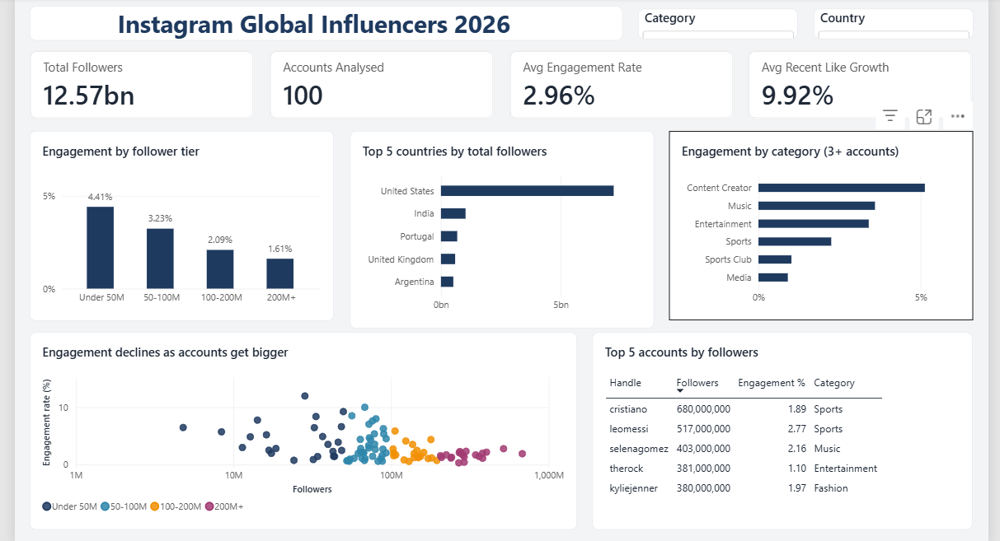

# Instagram Global Influencers 2026: SQL Analysis

SQL analysis of the top 100 Instagram accounts worldwide, exploring how follower count, category and country relate to audience engagement. A Power BI dashboard will present the results.

## Dashboard

## Dataset

100 accounts with followers, average likes, 60-day engagement rate, country and category. The data had no missing values or duplicates.

## Approach

1. Imported the CSV into SQL as `ig_raw`.
2. Built a cleaned view, `ig_clean`, standardising column names, reducing multi-value country and category fields to their primary value, and adding calculated engagement and like-growth metrics.
3. Answered 10 business questions using filtering, aggregation, `HAVING`, `CASE`, window functions and CTEs.

## Key Findings

- **The US dominates:** 47 of the 100 accounts and about 57% of total followers.
- **Bigger accounts engage less:** average engagement falls from 4.4% for accounts under 50M followers to 1.6% for those above 200M.
- **Content creators engage best:** 5.1% on average, ahead of music (3.6%) and sports (2.2%).
- **Recent posts are performing better:** all 100 accounts get more likes on recent posts than their historical average, about 10% more on average.

## Repository

- `instagram_influencers.sql`: cleaning view and all queries
- `instagram_global_influencers_2026.csv`: source data

## Tools

SQL, Power BI
